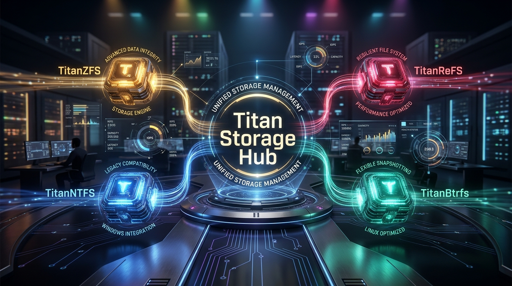

# Titan Storage Hub: Unified Drive Control Center for Windows

[](https://github.com/MicaNT-Kernel/TitanStorageHub/actions/workflows/ci.yml)
[](LICENSE)
[]()
[](CLEAN_ROOM_PROVENANCE.md)



**Titan Storage Hub** is the unified desktop control center for the **Titan Storage Suite** (`TitanZFS`, `TitanReFS`, `TitanNTFS`, and `TitanBtrfs`). Designed from first principles in modern ISO C++23 and pure Win32 dark-mode GUI architecture, Titan Storage Hub delivers centralized volume discovery, real-time bit-rot scrubber telemetry, subvolume snapshot browsing, filesystem formatting wizards, and background service management without kernel drivers or BSOD risks.

---

## Key Features

- **Unified Multi-Engine Control**: Direct Named Pipe IPC integration (`\\.\pipe\titanzfs_ipc`, `\\.\pipe\titanrefs_ipc`, `\\.\pipe\titanntfs_ipc`, and `\\.\pipe\titanbtrfs_ipc`) communicating with all Titan filesystem services simultaneously.
- **Automatic Filesystem Signature Detection (`DiskFormatDetector`)**: Instantly detects and categorizes disks, partitions, and image files using clean-room magic signatures:
  - **Btrfs**: `_BHRfS_M` at `0x10040` (64 KiB superblock offset)
  - **ReFS**: `"ReFS"` at byte offset `0x03`
  - **NTFS**: `"NTFS    "` at byte offset `0x03`
  - **ZFS**: Uberblock magic (`0x00bab10c`) & `zfs_pool` headers
  - **FAT32 & FAT16/FAT12**: BPB signatures (`"FAT32   "`, `"FAT16   "`) & volume labels
  - **exFAT**: `"EXFAT   "` at byte offset `0x03`
  - **ext4 / ext3 / ext2**: Linux superblock magic `0xEF53` at `0x438`, extent incompat flags, and volume labels
  - **XFS**: High-performance Linux superblock magic `"XFSB"` at offset `0x00`
  - **F2FS**: Flash-friendly Android/Linux filesystem magic `0xF2F52010` at offset `0x400`
  - **APFS & HFS+**: Apple filesystem container magic (`"NXSB"` at `0x20`) and Mac volume headers (`"H+"`)
  - **ISO 9660 & UDF**: Optical media & installer images (`"CD001"`, `"NSR02"`, `"NSR03"`)
  - **BitLocker**: Hardware/software encrypted volume headers (`"-FVE-FS-"`)
  - **Linux Swap**: Partition swap signatures (`"SWAPSPACE2"`)
- **System Drive & Physical Partition Auto-Discovery**: Automatically enumerates all active Windows logical drives (`C:\`, `D:\`, etc.), mounted Titan volumes, removable USB flash sticks, SDXC cards, optical media, and raw unmounted physical partitions (`\\.\PhysicalDriveX`).
- **Real-Time Bit-Rot Scrubber & Health Center**: Visual progress meters, live sector counters, and error recovery telemetry tracking automated background scrub operations across all mounted pools and volumes.
- **Subvolume & Snapshot Browser**: Inspect subvolume trees, snapshot hierarchies (`@`, `@home`, `@snapshots`), parent-child generations, and clone targets for Btrfs and ZFS datasets.
- **Partition & Format Wizard**: Quick-format disk images or physical drives to Btrfs, ReFS v3.12, NTFS, ZFS, FAT32, exFAT, ext4, or XFS with customized sector sizes, auto-detection on browse, and volume labels.
- **Windows Background Service Monitor**: Live status, start/stop controls, and pipe health diagnostics for `TitanZFS`, `TitanReFS`, `TitanNTFS`, and `TitanBtrfs` Windows NT services.
- **Modern Win32 Dark-Mode Architecture**: Left Navigation Sidebar layout (`980 x 640`), smooth Mica styling, GDI+ high-DPI hero graphics, and zero external GUI framework bloat.
- **System Tray Agent**: Background minimization, system notification area integration, and quick drive access menu.
- **Turnkey 1-Click Installer (`titanstoragehub_setup.exe`)**: Single-file installer bundling the desktop manager, hero artwork, and signed WinFsp runtime MSI using clean-room LZ4 PE overlay compression.
- **Clean-Room Compliance**: 100% written under 17 U.S.C. § 1201(f) & *Google v. Oracle* interoperability doctrines, audited by our automated Sentinel on every commit.

---

## Control Center Views

| View | Description |
| :--- | :--- |
| **Drives & Volumes** | Central dashboard listing all detected disks, partitions, mount drive letters, filesystem formats, and capacity usage. |
| **Scrubber & Health** | Real-time monitoring of automated scrubbing routines, scanned blocks, detected errors, and self-healed sectors. |
| **Subvolumes & Snapshots** | Hierarchical view of active subvolumes, CoW clones, and read-only backup snapshots. |
| **Format Wizard** | Turnkey volume preparation tool with filesystem format selection, sector alignment, and volume labeling. |
| **Services & System** | Windows NT Service Control Manager (SCM) probe for Titan background daemons and Named Pipe health. |

---

## Building from Source

### Prerequisites
- CMake 3.24+
- Modern C++23 Compiler (Clang 18+, MSVC 2022 v17.8+, or GCC 14+)
- Ninja build tool (recommended)

### Windows Build (Clang / Ninja)
```bash
cmake -B build -G Ninja -DCMAKE_BUILD_TYPE=Release
cmake --build build -j2
```

### Run Test Battery
```bash
ctest --test-dir build --output-on-failure
# Or directly:
./build/titanstoragehub_tests.exe
```

### Run Clean-Room Sentinel Audit
```bash
node scripts/clean_room_sentinel.js --local
```

### Create Distribution ZIP
```bash
cpack --config build/CPackConfig.cmake -B build/dist
```

---

## Legal & Clean-Room Architecture
Titan Storage Hub is an independent clean-room implementation developed for functional interoperability under 17 U.S.C. § 1201(f) and SCOTUS fair use doctrine (*Google v. Oracle*). See [CLEAN_ROOM_PROVENANCE.md](CLEAN_ROOM_PROVENANCE.md) for complete compliance documentation.

---

## License
Licensed under the Apache License, Version 2.0.  
Copyright © 2026 Daniel Elliott <ssfdre38@gmail.com>.
